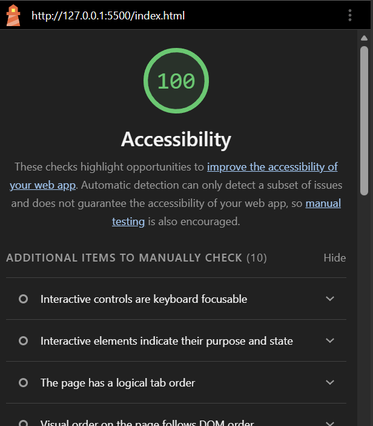

# MidTerm-Website

Page Departures:
The page departure from the additional project subpages were done since it seemed a bit redundant to have a page that overviews all projects - while also having multiple subpages looking even deeper into each individual project (when there isn't that much more explaining needed since its a portfolio piece and not a CV.) It was also a lot of unneeded extra work.

Skip Links and Accessibility:
Each page was tested through the Lighthouse feature in the development tools and have consistently scored 100 percent / score in terms of accessibility on every single page.

Minor Page Departure:
I changed the name of the "Legal" page to "Terms of Service" since it simply just made more sense. 

The page also is fully focused (for linked products) with a blue outline when tabbing or focusing on content.

Contact Form:
The contact form was created for business enquiries and times to which the freelancer is available to work. It is constructed to fit this set-up.

BreakPoint:
According to the test using developer tools the breakpoint of the page is approximately 848 pixels - where the page goes from a single column to a multi-column page (and vice versa) without hampering the readability of the page. 

Why Grid: it’s used where items need to line up in rows and columns.

Page layout: header, main content and footer are three rows, and Grid keeps the footer at the bottom of the screen.
Cards: one column on a phone, three equal columns on a wide screen.
Contact page: the form takes up two rows on the left, and the two tables stack on the right.

Why Flexbox: it’s used where items sit in one row.

Nav bar: the links sit side by side, with even spacing, and move to a new line on a small screen.
Footer icons: the three mail icons sit side by side in the same way.

Contrast Audit:
Text on background: 17.40:1
Text on surface: 15.81:1
Accent on background: 8.30:1 (links)
White on accent: 8.30:1 (button text)
Hover on background: 5.23:1 (link hover)
Hover on surface: 4.76:1
Focus on background: 5.98:1 (focus outline)
Focus on surface: 5.44:1
Border on background: 4.54:1
Border on surface: 4.13:1
White on black: 21:1 (skip link)